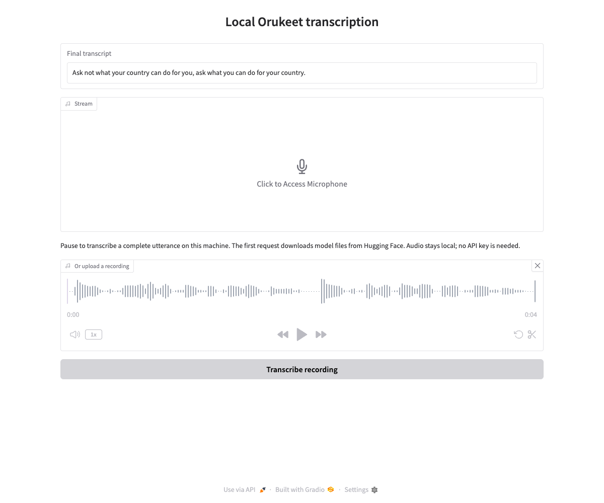

# Local Orukeet speech recognition

This example implements FastRTC's `STTModel` protocol with the [Orukeet](https://huggingface.co/oruk/orukeet) INT8 ONNX export. It runs on CPU and returns final text for a complete utterance. It supports 25 languages with automatic detection; it does not return interim text, a detected language code, word timestamps, confidence scores, or speaker labels.

From the repository root, in a Python virtual environment:

```sh
python -m pip install -e '.[vad]' -r demo/orukeet/requirements.txt
python -m demo.orukeet.app
```

Open the localhost address. Speak and pause, or upload a recording. `ReplyOnPause` uses VAD to collect a completed utterance; the model itself is not a streaming recognizer. No API key or hosted speech service is used. Audio stays on the machine running this example.



Use the adapter in another handler:

```python
from demo.orukeet.adapter import OrukeetSTT

model = OrukeetSTT()
text = model.stt((sample_rate, samples))
model.close()
```

Pass mono `(samples,)` or channel-first `(channels, samples)` audio as PCM16 or float32. Stereo is downmixed and the runtime resamples to 16 kHz when needed. One model instance serializes recognition. Close it when its owner shuts down; closing waits for active native inference to finish.

## Model download and offline use

The first recognition downloads required model/configuration files and license notices from Hugging Face revision `1751fce6ecde442f14543cf1804800c49b3e415c`. Four runtime files are checked against pinned SHA-256 hashes. The required `config.json` participates in Hugging Face's normal model download accounting. Complete cache hits make no HTTP requests; inference sends no audio or counting requests.

Choose a Hub cache with `OrukeetSTT(cache_dir="...")`. After the first successful load, `OrukeetSTT(local_files_only=True)` requires cached files and works offline. The demo's Silero VAD also needs its own initial cache download. For a checksum error, remove only the named corrupt cached file and download it again.

The weights use **CC BY-SA 4.0**, retaining NVIDIA foundation attribution. The downloader includes the weight license, notices, and converter/preprocessor licenses. The example code is MIT-licensed.
